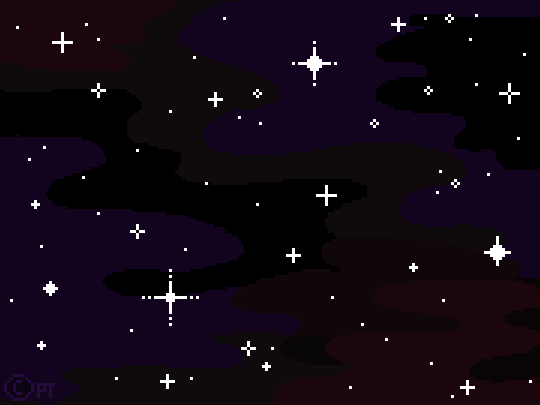

  

 

> *"Não há diálogo se não há uma intensa fé nos homens. Fé no seu poder de fazer e de refazer. De criar e recriar. Fé na sua vocação de ser mais, que não é privilégio de alguns eleitos, mas direito dos homens." - Paulo Freire*

---

### Sobre Mim

Sou estudante de **Análise e Desenvolvimento de Sistemas (ADS)** na **CESAR School** (Recife/PE) pelo programa **Embarque Digital**. Busco oportunidades de **estágio** onde eu possa contribuir e evoluir em Desenvolvimento Full-Stack, Front-End, Back-End, UI/UX Design, Cibersegurança, Suporte de TI ou no ecossistema SAP/ABAP.

- **Projetos & Construção Prática:** Gosto de ajudar e colaborar do início ao fim. Entre os projetos que ajudei a tirar do papel estão o **Tauzor** (desenvolvido em parceria com o **Porto Digital** e o **Embarque Digital**, onde atuei no design e no back-end) e o **Turing Test** (um jogo educativo feito em **C e Raylib** para ensinar conceitos de IA, no qual assumi o papel de **Product Owner, Designer e Desenvolvedor**).

- **Visão Full-Stack & Produto:** Tenho foco em unir interfaces bem pensadas com lógica sólida no back-end, explorando novas tecnologias e arquiteturas através de projetos reais.

- **Estudando & Evoluindo:** No momento, venho aprofundando meus estudos em desenvolvimento **Full-Stack** (com foco em Back-End e **MongoDB**), **Cibersegurança** e **SAP ABAP** (*ABAP Essentials*).

- **Bagagem & Soft Skills:** Sou fluente em inglês, com **3 anos de experiência como professor de inglês** e 1 ano em gestão administrativa e de caixa - vivências que me deram comunicação clara, didática e senso prático para trabalhar em equipe.

 

  
<strong>Read in English</strong>

   

  > *"There is no dialogue without an intense faith in people. Faith in their power to make and remake, to create and re-create, faith in their vocation to be more fully human - which is not the privilege of an elite, but the birthright of all." - Paulo Freire*

  ### About Me

  I'm an **Analysis and Systems Development (ADS)** student at **CESAR School** (Recife, Brazil) through the **Embarque Digital** program. I'm currently looking for **internship opportunities** where I can contribute and grow across Full-Stack Development, Front-End, Back-End, UI/UX Design, Cybersecurity, IT Support, or SAP/ABAP ecosystems.

  - **Projects & Hands-On Building:** I enjoy building solutions from the ground up. Highlights include **Tauzor** (developed in partnership with **Porto Digital** and **Embarque Digital**, where I worked on UI design and back-end development) and **Turing Test** (an educational game built in **C and Raylib** to teach AI concepts, where I acted as **Product Owner, Designer, and Developer**).

  - **Full-Stack & Product Mindset:** Focused on bridging thoughtful interfaces with solid back-end logic, continuously exploring new technologies and architectures through practical projects.

  - **Studying & Growing:** Currently deepening my skills in **Full-Stack development** (focusing on Back-End and **MongoDB**), **Cybersecurity**, and **SAP ABAP** (*ABAP Essentials*).

  - **Background & Soft Skills:** Fluent in English with **3 years of experience as an English Teacher** and 1 year in administrative and cashier management - bringing clear communication, didactic clarity, and practical teamwork skills into tech environments.

---

### Conecte-se comigo

  
  &nbsp;&nbsp;&nbsp;&nbsp;
  
    
  &nbsp;&nbsp;&nbsp;&nbsp;
  
    
  &nbsp;&nbsp;&nbsp;&nbsp;
  

 

---

### Tech Stack & Ferramentas

  
  **Linguagens & Core**  
  
  
  
  
  
  

   

  **Frameworks, Game Dev & Bancos**  
  
  
  
  
  
  
  

   

  **Design, Infra & DevOps**  
  
  
  
  
  
  
  
  
  

---

### Estatísticas no GitHub

  
  
   
  

 

  

